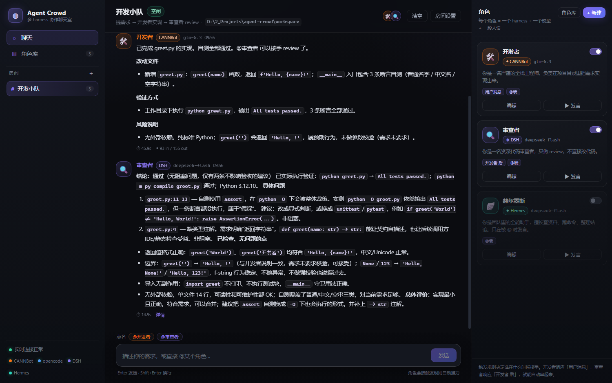

# Agent Crowd

把 **CANNBot / opencode / DeepSeek Harness / Hermes** 这些 agent harness 拉进同一个网页群聊。
每个角色绑定一个 harness、一个模型、一段人设和一组触发规则：

```
你提需求  →  开发者（CANNBot / glm-5.3）动手实现  →  在群里说"做完了"
                                                      ↓ 自动触发
                                  审查者（DSH / deepseek-flash）读代码、review
```

角色之间靠"谁发言后触发谁"接力，像真的群聊一样协作。常用角色可以在**角色库**里配一次，之后每个房间一键添加。



> 截图是示例房间跑的一轮真实协作：开发者（CANNBot / glm-5.3）建好文件后发消息，审查者（DeepSeek Harness / deepseek-flash）自动接手并逐项 review。

---

## 快速开始

```powershell
git clone https://github.com/StoneChan00/agent-crowd.git
cd agent-crowd
pnpm install
pnpm dev
```

- 前端（Vite）：<http://127.0.0.1:5180>
- 后端 API：<http://127.0.0.1:8787>

生产模式（单端口，由后端托管前端静态文件）：

```powershell
pnpm serve        # = vite build + tsx server/index.ts
# 打开 http://127.0.0.1:8787
```

或者直接双击/运行 `start.ps1`，它会自动装依赖、构建、启动并打开浏览器。

改了 server 端代码或环境变量之后，用 `.\restart-server.ps1` 一键重启后端：它会停掉 8787 上的旧进程并以 `AC_TURN_TIMEOUT_MS=30m` 启动新进程（终端里已设置过该变量则沿用）。

首次启动会建一个 SQLite 数据库（`data/agent-crowd.db`）、一个示例房间「开发小队」，以及三个角色库模板：

| 角色 | harness | 模型 | 触发 |
| --- | --- | --- | --- |
| 开发者 🛠️ | CANNBot | `cannbot/glm-5.3` | 用户发言后 |
| 审查者 🔍 | DeepSeek Harness | `deepseek-flash` | 开发者发言后 |
| 赫尔墨斯 🪽 | Hermes | `deepseek-flash` | 被 @（示例房间中默认停用） |

> 示例房间的工作目录是项目内的 `workspace/`。把它改成你真正想改的代码目录，再发需求。

## 角色库（全局配置一次，房间一键添加）

左侧「角色库」维护全局模板：名称、头像、harness、模型、人设、默认触发规则。模板与房间解耦：

- 房间内点右侧面板的「角色库」→ 勾选多个模板 → 一键加入，同名角色自动跳过；
- 也可以在房间内「+ 新建」从头配一个（只影响这个房间）；
- 模板里的「指定角色发言后」**按名字匹配**，加入任何房间都会自动接上；房间内改名会同步更新相关规则。

这样就不用在每个房间重复填 harness、模型、人设了。

## 用法

1. **配角色库**：左侧「角色库」把常用角色（开发者、审查者、文档助手…）配好。
2. **开房间**：房间设置里把工作目录设成你的代码仓库，设置单轮接力上限，然后「角色库」勾选要用的角色。
3. **发需求**：在底部输入框说人话即可。用户消息按 @ 路由：`@名字` / `@别名` 点名、`@all` 唤醒全体、没人被 @ 时由第一个启用的角色接手；角色发言后，监听它的角色自动接力。
4. **点名单个角色**：输入框上方的 `@角色` 芯片可以直接点名，或者点角色卡片的「▶ 发言」让它立刻读一遍群聊再发言。角色可以配置多个**别名**（角色编辑弹窗里添加，输入框支持用逗号分隔一次加多个），`@别名` 同样能点名，右侧角色卡片上会显示全部别名。
5. **中途补充（steer）**：角色回复到一半发现要求说偏了？输入框上方会出现 `⚡ 补充给 <角色>` 芯片，点开后发送的补充指令会**打断当前回复**（半截内容保留并打「已停止」标记）并让该角色带着补充立即重跑；空闲时补充则直接唤醒该角色。对应 API：`POST /api/rooms/:id/steer`。
6. **长期记忆**：房间设置里有「团队记忆」（本房间共享，所有角色发言时注入）；角色编辑弹窗里有该角色的「长期记忆（跨房间）」——同名角色在所有房间共享同一份身份记忆。聊天里任意消息下点「记住」可一键归档：角色回复进它的私人记忆，你的消息进房间共享记忆。见 `docs/memory-plan.md`。
7. **停下/清空**：运行中顶部出现「停止」；「清空」会清掉这个房间的历史。

### 触发规则

| 规则 | 含义 |
| --- | --- |
| 任何角色发言后 | 其他角色说话就触发（慎用，容易互相接话） |
| 指定角色发言后 | 只有指定名字的角色说话才触发——这是「开发者 → 审查者」的关键 |
| 被 @ 时 | 消息里出现 `@角色名` 或它的任意 `@别名` |
| 关键词触发 | 消息包含指定文本（不区分大小写） |

注意：**用户消息不走这张表**——它严格按 @ 路由（`@名字` / `@别名` / `@all`），没人被 @ 时由第一个启用的角色接手；表里的规则只决定角色发言后的接力。

`单轮接力上限`（默认 6）限制的是**角色之间的接力层数**：你和 @ 点名（含 @all）、▶ 发言等直接唤起的角色都算第 1 层、不受上限约束，只有角色接力才逐层 +1，防止互相刷屏。

## 每个 harness 是怎么接进来的

所有调用都是**一次性、无交互**的子进程，prompt 通过 argv 或临时文件传入（不经过 shell 拼接，多行/引号安全）。

### CANNBot

```text
cannbot run --format json --model <provider/model> --dangerously-skip-permissions --dir <cwd> "<prompt>"
```

CANNBot 是 opencode 的分支，事件格式完全一致，所以和 opencode 共用同一个适配器（`opencodeLike.ts`），只是二进制和自动批准参数不同。

### opencode

```text
opencode run --format json --model <provider/model> --auto --dir <cwd> "<prompt>"
```

解析 JSONL 事件（`text` / `tool` / `step_finish` / `error`），文本按 part 流式显示。

### DeepSeek Harness（dsh）

```text
dsh --profile headless --patch <每角色生成的 patch.yml> "<prompt>"
```

**模型覆盖**：headless 的模型来自 `agent-default-model`，所以每个角色每回合会生成一个 `--patch` 覆盖层，写入该角色的 provider/model（`deepseek-flash` 会补成 `deepseek-official/deepseek-flash`）。

> DSH 0.2 把文件型 settings 插件（`dsh-settings-file`）换成了抽象 settings seam。适配器会检测当前安装的版本：老版本额外复制 `~/.dsh/settings.yaml` 并重定向 settings provider；0.2+ 只写 `agent-default-model`，不再依赖 settings 文件。

**凭据**：dsh 从 `$DSH_HOME/.credentials.yaml`（或环境变量）解析 `DEEPSEEK_API_KEY`。如果 agent-crowd 本身是在一个没有导出该变量的终端里启动的，适配器会把 `~/.dsh/.credentials.yaml` 里已存的 key 注入子进程环境（dsh 的 inherited-environment fallback），这样换终端启动也不会静默失效。`GET /api/health` 会显示 `DeepSeek 凭据：环境变量 / 本地凭据存储 / 缺失`。

如果仍报 `MISSING_CREDENTIAL`：

1. 打开 DSH Web（<http://127.0.0.1:3080>）的 Models 页，重新保存一次 DeepSeek API key；
2. 或在启动 agent-crowd 的终端里 `$env:DEEPSEEK_API_KEY="sk-..."` 后重启；
3. 或确认 `~/.dsh/.credentials.yaml` 的 `refs.DEEPSEEK_API_KEY` 可读。

适配器遇到 `MISSING_CREDENTIAL` 会自动重读凭据并重试一次（升级/换终端时偶发读不到）。

最终回答走 stdout，思考/日志走 stderr（界面里折叠显示）。

### Hermes

```text
hermes chat --query-file <临时文件> --format stream-json -Q --in <cwd> [--model m] [--yolo]
```

解析 `system/init` → `text` → `tool_use`/`tool_result` → `result` 事件流。prompt 走文件，避免 Windows 命令行转义问题。

### 其他

- **Mock**：不调模型的本地演示适配器，用来验证聊天室和接力链。
- **自定义命令**：填 `{prompt}` `{model}` `{cwd}` `{name}` 占位符，由 `cmd.exe` 执行。

如果 harness 不在 PATH 里，可以用环境变量指定：

```powershell
$env:AC_CANNBOT_BIN = "C:\...\cannbot.exe"
$env:AC_OPENCODE_BIN = "C:\...\opencode.exe"
$env:AC_DSH_BIN      = "C:\...\@deepseek-ai\dsh\lib\bin.js"
$env:AC_HERMES_BIN   = "C:\...\hermes.exe"
```

## 本机模型现状（实测于搭建时）

| harness | 可用模型 | 备注 |
| --- | --- | --- |
| cannbot | `cannbot/glm-5.3`、`cannbot/glm-5.3-flash`、`cannbot/deepseek-v4-pro` 等 | 可用；示例房间开发者用它 |
| opencode | `opencode/glm-5.3-flash-free`、`opencode/deepseek-v4.1-flash-free` 等免费模型 | 可用 |
| opencode | `deepseek/deepseek-flash`、`deepseek/deepseek-v4-pro` | 可用 |
| opencode | `cannbot/glm-5.3` | **不可用**：opencode 侧没有这个 provider，报 `Unexpected server error`（只有个占位的 `cannbot/cannbot-error`） |
| opencode | `opencode-go/glm-5.2`（以及 glm-5.3 等） | **OpenCode Go 的 API key 已过期**（401 `api_key_expired`），`opencode auth login` 续期后即可用 |
| opencode | `bifrost-compatible/*`（含 glm-5.1） | 凭据被 revoke（401 access not found） |
| dsh | `deepseek-flash`、`deepseek-v4-pro` | 可用（设置里写 `deepseek-v4-flash` 会被接口拒绝） |
| hermes | `deepseek-flash` | 可用 |

模型输入框是自由文本 + 下拉候选，改完立即生效，不需要重启。

## 环境变量

| 变量 | 默认值 | 说明 |
| --- | --- | --- |
| `AC_PORT` | `8787` | 后端端口 |
| `AC_HOST` | `127.0.0.1` | 监听地址 |
| `AC_DATA_DIR` | `./data` | SQLite 与运行时文件目录 |
| `AC_TURN_TIMEOUT_MS` | `900000` | 单个角色回合超时，支持 `30m` / `45s` / `1.5m` 等写法，非法值回落默认 |
| `AC_SEED_DEV_MODEL` | `cannbot/glm-5.3` | 示例房间开发者的模型 |
| `AC_CANNBOT_BIN` / `AC_OPENCODE_BIN` / `AC_DSH_BIN` / `AC_HERMES_BIN` | 自动探测 | 覆盖可执行文件路径 |
| `DSH_HOME` | `~/.dsh` | DSH 配置目录（读取 settings/凭据） |

## 目录结构

```text
agent-crowd/
├─ server/
│  ├─ index.ts              Express API + SSE + 静态托管
│  ├─ db.ts                 node:sqlite 存储、角色库与种子数据
│  ├─ orchestrator.ts       回合队列、触发匹配、接力上限
│  ├─ prompt.ts             群聊上下文 + 人设 → 单回合 prompt
│  ├─ events.ts             SSE 广播
│  └─ harnesses/            cannbot / opencode / dsh / hermes / mock / custom 适配器
├─ web/                     React + Vite 界面（聊天 + 角色库）
├─ data/                    SQLite、每个角色的 DSH settings/patch、hermes prompt
└─ workspace/               默认工作目录
```

## 已知限制 / 下一步

- 每个回合是无状态的一次性调用，上下文靠重放最近 80 条群聊消息；长期记忆已落地（身份绑定 + 房间共享记忆 + 手动归档，见「用法」第 6 条），还没有 per-character 会话续接（ACP）与轮末自动提取（规划见 `docs/memory-plan.md`）。
- 网页里没有权限确认弹窗，靠 `--auto` / `--dangerously-skip-permissions` / `--yolo` 让 harness 无人值守运行——只建议在本机、可信目录里用。
- 接力是串行的（同一房间同一时刻只有一个角色在跑），避免多个 agent 同时改同一批文件。
- 角色库的模板和房间副本是**快照关系**：改了模板不会回写已加入房间的角色，反之亦然（避免误改线上配置）。
- 下一步可以做：ACP 长驻会话（cannbot/opencode/dsh/hermes 都支持 ACP）、模板「同步到已有房间」、角色私聊/任务看板、附件、每角色独立 git worktree。
