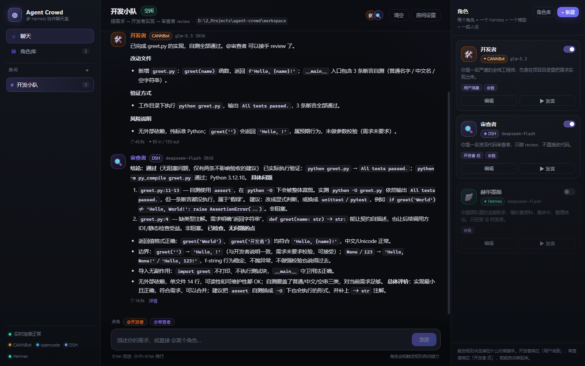

# Agent Crowd

把 **CANNBot / opencode / DeepSeek Harness / Hermes** 这些 agent harness 拉进同一个网页群聊。
每个角色绑定一个 harness、一个模型、一段人设和一组触发规则：

```
你提需求  →  GLM（CANNBot / glm-5.3）动手实现  →  在群里说"做完了"
                                                      ↓ 点名接力
                                  DeepSeek（DSH / deepseek-flash）读代码、review
```

角色之间靠"谁发言后触发谁"接力，像真的群聊一样协作。常用角色可以在**角色库**里配一次，之后每个房间一键添加。



> 截图是示例房间跑的一轮真实协作：开发者（CANNBot / glm-5.3）建好文件后发消息，审查者（DeepSeek Harness / deepseek-flash）自动接手并逐项 review。（截图摄于旧版角色名与自动接力时期；现默认阵容为 GLM / DeepSeek / Qwen / Claude / GPT，GLM→DeepSeek 的 review 改为 @点名。）

---

## 快速开始

前置依赖：Node.js ≥ 23.6（server 依赖内置 `node:sqlite`，`npm test` 的护栏脚本直接 import `.ts` 依赖类型剥离，均需该版本起才无需实验标志；开发实测 v24）与 pnpm（`npm install -g pnpm` 可装）。

```powershell
git clone https://github.com/StoneChan00/agent-crowd.git
cd agent-crowd
pnpm install
pnpm dev
```

- 前端（Vite）：<http://127.0.0.1:5180>
- 后端 API：<http://127.0.0.1:8787>

生产模式（单端口，由后端托管前端静态文件）：

```powershell
pnpm serve        # = vite build + tsx server/index.ts
# 打开 http://127.0.0.1:8787
```

或者直接双击/运行 `start.ps1`，它会自动装依赖、构建、启动并打开浏览器。

改了 server 端代码或环境变量之后，用 `.\restart-server.ps1` 一键重启后端：它会停掉 8787 上的旧进程并以 `AC_TURN_TIMEOUT_MS=60m` 启动新进程（终端里已设置过该变量则沿用）。

开发自检：改完代码跑 `npm test`（回归护栏，覆盖回合超时、进程树清理、markdown 换行契约，不依赖 NPU/外部服务）。

首次启动会建一个 SQLite 数据库（`data/agent-crowd.db`）、一个示例房间「开发小队」，以及五个角色库模板：

| 角色 | harness | 模型 | 触发 |
| --- | --- | --- | --- |
| GLM | CANNBot | `cannbot/glm-5.3` | 用户发言后（没人被 @ 时由它接手） |
| DeepSeek | DeepSeek Harness | `deepseek-flash` | 被 @（点名 review） |
| Qwen | CANNBot | `cannbot/qwen3.8-max` | 被 @；每轮结束后总结 |
| Claude | Claude Code | 默认模型 | 被 @（别名：克劳德） |
| GPT | Codex | 默认模型 | 被 @ |

> 示例房间的工作目录是项目内的 `workspace/`。把它改成你真正想改的代码目录，再发需求。

## 角色库（全局配置一次，房间一键添加）

左侧「角色库」维护全局模板：名称、头像、harness、模型、人设、默认触发规则。模板与房间解耦：

- 房间内点右侧面板的「角色库」→ 勾选多个模板 → 一键加入，同名角色自动跳过；
- 也可以在房间内「+ 新建」从头配一个（只影响这个房间）；
- 模板里的「指定角色发言后」**按名字匹配**，加入任何房间都会自动接上；房间内改名会同步更新相关规则。

这样就不用在每个房间重复填 harness、模型、人设了。

## 用法

1. **配角色库**：左侧「角色库」把常用角色（开发者、审查者、文档助手…）配好。
2. **开房间**：房间设置里把工作目录设成你的代码仓库，设置单轮接力上限，然后「角色库」勾选要用的角色。
3. **发需求**：在底部输入框说人话即可。用户消息按 @ 路由：`@名字` / `@别名` 点名、`@all` 唤醒全体、没人被 @ 时由第一个启用的角色接手；角色发言后，监听它的角色自动接力。
4. **点名单个角色**：输入框上方的 `@角色` 芯片可以直接点名，或者点角色卡片的「▶ 发言」让它立刻读一遍群聊再发言。角色可以配置多个**别名**（角色编辑弹窗里添加，输入框支持用逗号分隔一次加多个），`@别名` 同样能点名，右侧角色卡片上会显示全部别名。
5. **中途补充（steer）**：角色回复到一半发现要求说偏了？输入框上方会出现 `⚡ 补充给 <角色>` 芯片，点开后发送的补充指令会**打断当前回复**（半截内容保留并打「已停止」标记）并让该角色带着补充立即重跑；空闲时补充则直接唤醒该角色。对应 API：`POST /api/rooms/:id/steer`。
6. **长期记忆**：房间设置里有「团队记忆」（本房间共享，所有角色发言时注入）；角色编辑弹窗里有该角色的「长期记忆（跨房间）」——同名角色在所有房间共享同一份身份记忆。聊天里任意消息下点「记住」可一键归档：角色回复进它的私人记忆，你的消息进房间共享记忆。见 `docs/memory-plan.md`。
7. **停下/清空**：运行中顶部出现「停止」；「清空」会清掉这个房间的历史。
8. **技能**：仓库 `skills/` 下每个 `.md` 是一个技能；在角色编辑里勾选后，本轮消息命中关键词或显式 `@skill:名字` 才注入正文，否则只带一行目录，避免撑爆 prompt。
9. **场景模板**：右侧「角色库」→「添加角色」弹窗顶部有三套模板（开发小队 / 写作室 / 调研小组），一键把整套角色加进房间；同名角色自动跳过。
10. **多房间与隔离**：两个未隔离房间指向同一目录时，设置里会告警，服务器按工作目录加执行锁（后到的回合排队，不会并发写）。需要并行改同一仓库时，在房间设置里「创建隔离工作树」：独立 checkout + `ac/<roomId>` 分支，源仓库未提交改动不会带过去，解除隔离后分支保留。
11. **状态与轮次报告**：顶部「状态」抽屉显示当前回合、队列、gate、最近轮次证据和崩溃日志；「轮次报告」列出每轮的改动文件、交付文本、review/verify/commit 证据和 token，可展开 `git show` diff、导出 markdown，或对已提交轮次发起**事后盲审**（reviewer 只拿到原始需求 + diff，看不到聊天记录）。顶部「用量」按角色聚合 harness 上报的 token。
12. **记忆来源与教训生命周期**：自动 episode 和失败教训带来源轮次，房间设置里可一键跳回原消息；同一失败第二次出现会升级为「常驻」，90 天未再出现自动降权。

### 触发规则

| 规则 | 含义 |
| --- | --- |
| 任何角色发言后 | 其他角色说话就触发（慎用，容易互相接话） |
| 指定角色发言后 | 只有指定名字的角色说话才触发——固定搭档的自动接力；默认阵容未启用它（GLM→DeepSeek 的 review 靠「被 @」点名） |
| 被 @ 时 | 消息里出现 `@角色名` 或它的任意 `@别名` |
| 关键词触发 | 消息包含指定文本（不区分大小写） |
| 每轮结束后总结 | 轮次干净收尾后，勾选的角色自动发一条本轮总结（做了什么、遗留了什么）；手动停止或被门禁拦截的轮次不总结 |

注意：**用户消息不走这张表**——它严格按 @ 路由（`@名字` / `@别名` / `@all`），没人被 @ 时由第一个启用的角色接手；表里的规则只决定角色发言后的接力。「每轮结束后总结」是唯一不在接力链上的规则：它在轮次收尾时触发，而不是某次发言之后。

工作目录在 git 仓库内的房间，轮次干净收尾（review PASS、验证未失败）时，本轮的代码改动会由服务器**自动提交为一个 commit**：主题带交付摘要（`auto:` 前缀），正文带改动清单与 review 结论；被 `.gitignore` 的文件自动跳过，你预先暂存的其他内容不会混进 auto 提交。**push 永远不会自动执行**——需要推送时在群里说一声（任意角色都能执行 `git push`），或自己推。手动停止或被门禁拦截的轮次不提交。

**聊天内媒体**：角色在回复里写一行 `[media] <文件的绝对路径>`（png/jpg/jpeg/webp/gif/mp4/webm），服务器会把它换成短链、图片和视频**直接显示在聊天气泡里**（图片点开看原图，视频可拖进度条）。文件服务走 `GET /api/files?path=<绝对路径>`，只放行落在某个房间工作目录（或角色工作目录）下的媒体扩展名，路径先 `realpath` 再比对白名单根，`..` 与符号链接无法逃逸。注意：默认 `AC_HOST=127.0.0.1` 只监听本机；若设成 `0.0.0.0`，这个端点也会对局域网可读，由你自行权衡。生成文件被删除或移动后对应消息会破图（长期归档的 copy-on-read 留作二期）。

**超时恢复阶梯**：回合超时被截断时，被杀 CLI 的会话仍留在磁盘上，服务器按**恢复阶梯**自动处理（默认 2 段，`AC_RESUME_ATTEMPTS` 可调）：第 1 段**恢复原会话续跑**（指令带上超时诊断——卡在哪个工具、静默了多久——并**明令禁止原样重跑那条卡死的命令**，要求换方式绕过）；第 1 段若毫无进展（无新文本、无完成的工具）则判定会话可疑，**清掉会话换全新会话要一轮纯汇报**（只总结已完成/卡点/建议，不执行任何命令）；第 1 段有进展但仍超时则进入第 2 段**只收尾**（禁止再执行新的长命令）。恢复轮有独立的短静默预算（默认 3 分钟，`AC_RESUME_IDLE_TIMEOUT_MS`），最坏 10+3+3 分钟内一定结算。**连续 3 次超时自动熔断**：停止自动恢复并发出诊断（含卡住工具与各次耗时），一次成功即清零。半截产出照常落库并标记可能不完整。需要声明了续传能力的 harness（opencode/cannbot/claude/codex）且有会话 id 才会乘坐会话；`AC_SESSION_RESUME=0` 只关乘坐不关记账。恢复档位（`turns.resume_attempt`）落库，服务器重启后队列恢复不降档。

**静默预警**：回合静默到看门狗预算的 50% 时广播一次 `alive_but_silent`、85% 时广播 `suspected_stall`（SSE `liveness` 事件，供 UI 使用）并在聊天里发**至多一条**「⚠️ 已静默 N 分钟，疑似卡住」系统消息——只报告、不影响击杀计时；把"还要不要等"提前交到你手上，而不是 10 分钟后突然一刀。

`单轮接力上限`（默认 6）限制的是**角色之间的接力层数**：你和 @ 点名（含 @all）、▶ 发言等直接唤起的角色都算第 1 层、不受上限约束，只有角色接力才逐层 +1，防止互相刷屏。

## 每个 harness 是怎么接进来的

所有调用都是**一次性、无交互**的子进程，prompt 通过 argv 或临时文件传入（不经过 shell 拼接，多行/引号安全）。

### CANNBot

```text
cannbot run --format json --model <provider/model> --dangerously-skip-permissions --dir <cwd> "<prompt>"
```

CANNBot 是 opencode 的分支，事件格式完全一致，所以和 opencode 共用同一个适配器（`opencodeLike.ts`），只是二进制和自动批准参数不同。

### opencode

```text
opencode run --format json --model <provider/model> --auto --dir <cwd> "<prompt>"
```

解析 JSONL 事件（`text` / `tool` / `step_finish` / `error`），文本按 part 流式显示。

### DeepSeek Harness（dsh）

```text
dsh --profile headless --patch <每角色生成的 patch.yml> "<prompt>"
```

**模型覆盖**：headless 的模型来自 `agent-default-model`，所以每个角色每回合会生成一个 `--patch` 覆盖层，写入该角色的 provider/model（`deepseek-flash` 会补成 `deepseek-official/deepseek-flash`）。

**权限**：headless 默认沙箱是 `workspace-write`（工作区外只读、进程受限），且「自动批准」开关在 0.2.x 的 dsh 上原生对应 `--permission-mode danger-full-access` 预设（沙箱全开 + 审批 never）。角色的「自动批准工具调用」勾选时适配器会带上该旗标；不勾则维持 dsh 自己的默认沙箱。全局放开也可以：启动 agent-crowd 的终端里设 `$env:DSH_PERMISSION_MODE="danger-full-access"`（dsh 官方的环境变量通道，作用于所有 dsh 回合）。

> DSH 0.2 把文件型 settings 插件（`dsh-settings-file`）换成了抽象 settings seam。适配器会检测当前安装的版本：老版本额外复制 `~/.dsh/settings.yaml` 并重定向 settings provider；0.2+ 只写 `agent-default-model`，不再依赖 settings 文件。

**凭据**：dsh 从 `$DSH_HOME/.credentials.yaml`（或环境变量）解析 `DEEPSEEK_API_KEY`。如果 agent-crowd 本身是在一个没有导出该变量的终端里启动的，适配器会把 `~/.dsh/.credentials.yaml` 里已存的 key 注入子进程环境（dsh 的 inherited-environment fallback），这样换终端启动也不会静默失效。`GET /api/health` 会显示 `DeepSeek 凭据：环境变量 / 本地凭据存储 / 缺失`。

如果仍报 `MISSING_CREDENTIAL`：

1. 打开 DSH Web（<http://127.0.0.1:3080>）的 Models 页，重新保存一次 DeepSeek API key；
2. 或在启动 agent-crowd 的终端里 `$env:DEEPSEEK_API_KEY="sk-..."` 后重启；
3. 或确认 `~/.dsh/.credentials.yaml` 的 `refs.DEEPSEEK_API_KEY` 可读。

适配器遇到 `MISSING_CREDENTIAL` 会自动重读凭据并重试一次（升级/换终端时偶发读不到）。

最终回答走 stdout，思考/日志走 stderr（界面里折叠显示）。

### Hermes

```text
hermes chat --query-file <临时文件> --format stream-json -Q --in <cwd> [--model m] [--yolo]
```

解析 `system/init` → `text` → `tool_use`/`tool_result` → `result` 事件流。prompt 走文件，避免 Windows 命令行转义问题。

### 其他

- **Mock**：不调模型的本地演示适配器，用来验证聊天室和接力链。
- **自定义命令**：填 `{prompt}` `{model}` `{cwd}` `{name}` 占位符，由 `cmd.exe` 执行。

如果 harness 不在 PATH 里，可以用环境变量指定：

```powershell
$env:AC_CANNBOT_BIN = "C:\...\cannbot.exe"
$env:AC_OPENCODE_BIN = "C:\...\opencode.exe"
$env:AC_DSH_BIN      = "C:\...\@deepseek-ai\dsh\lib\bin.js"
$env:AC_HERMES_BIN   = "C:\...\hermes.exe"
```

## 本机模型现状（实测于搭建时）

| harness | 可用模型 | 备注 |
| --- | --- | --- |
| cannbot | `cannbot/glm-5.3`、`cannbot/glm-5.3-flash`、`cannbot/deepseek-v4-pro` 等 | 可用；示例房间 GLM 用它 |
| opencode | `opencode/glm-5.3-flash-free`、`opencode/deepseek-v4.1-flash-free` 等免费模型 | 可用 |
| opencode | `deepseek/deepseek-flash`、`deepseek/deepseek-v4-pro` | 可用 |
| opencode | `cannbot/glm-5.3` | **不可用**：opencode 侧没有这个 provider，报 `Unexpected server error`（只有个占位的 `cannbot/cannbot-error`） |
| opencode | `opencode-go/glm-5.2`（以及 glm-5.3 等） | **OpenCode Go 的 API key 已过期**（401 `api_key_expired`），`opencode auth login` 续期后即可用 |
| opencode | `bifrost-compatible/*`（含 glm-5.1） | 凭据被 revoke（401 access not found） |
| dsh | `deepseek-flash`、`deepseek-v4-pro` | 可用（设置里写 `deepseek-v4-flash` 会被接口拒绝） |
| hermes | `deepseek-flash` | 可用 |

模型输入框是自由文本 + 下拉候选，改完立即生效，不需要重启。

## 环境变量

| 变量 | 默认值 | 说明 |
| --- | --- | --- |
| `AC_PORT` | `8787` | 后端端口 |
| `AC_HOST` | `127.0.0.1` | 监听地址 |
| `AC_DATA_DIR` | `./data` | SQLite 与运行时文件目录 |
| `AC_TURN_TIMEOUT_MS` | `3600000` | 单个角色回合超时，支持 `60m` / `45s` / `1.5m` 等写法，非法值回落默认 |
| `AC_IDLE_TIMEOUT_MS` | `600000` | 静默看门狗：回合**连续无输出**超过该时长才判卡死杀进程（任何输出字节都重置计时；持续产出的回合能活到总上限）。支持 `30m` / `90s` 等写法，`0` / `off` / `none` 关闭，非法值回落默认 |
| `AC_RESUME_ATTEMPTS` | `2` | 超时自动续跑的段数（恢复阶梯：第 1 段"从中断处继续"，第 2 段"只收尾汇报"）；`0` 关闭整个自动恢复 |
| `AC_RESUME_IDLE_TIMEOUT_MS` | `180000` | 恢复轮（续跑/汇报）专用的静默看门狗预算——比普通回合短得多，卡住的恢复几分钟内结算而不是再烧一个完整静默窗口。写法同上，`0` / `off` 关闭 |
| `AC_SEED_DEV_MODEL` | `cannbot/glm-5.3` | 示例房间 GLM 的模型 |
| `AC_CANNBOT_BIN` / `AC_OPENCODE_BIN` / `AC_DSH_BIN` / `AC_HERMES_BIN` | 自动探测 | 覆盖可执行文件路径 |
| `DSH_HOME` | `~/.dsh` | DSH 配置目录（读取 settings/凭据） |

## 目录结构

```text
agent-crowd/
├─ server/
│  ├─ index.ts              Express API + SSE + 静态托管
│  ├─ db.ts                 node:sqlite 存储、角色库与种子数据
│  ├─ orchestrator.ts       回合队列、触发匹配、接力上限
│  ├─ prompt.ts             群聊上下文 + 人设 → 单回合 prompt
│  ├─ events.ts             SSE 广播
│  └─ harnesses/            cannbot / opencode / dsh / hermes / mock / custom 适配器
├─ web/                     React + Vite 界面（聊天 + 角色库）
├─ data/                    SQLite、每个角色的 DSH settings/patch、hermes prompt
└─ workspace/               默认工作目录
```

## 已知限制 / 下一步

- 每个回合仍是**一次性 CLI 调用**；有会话续接（P0-1）和超时恢复阶梯（M3），但不是 ACP 长驻进程。上下文靠提示层重放最近消息，超预算会折叠较早记录。
- 网页里没有权限确认弹窗，靠 `--auto` / `--dangerously-skip-permissions` / `--yolo` 让 harness 无人值守运行——只建议在本机、可信目录里用。`AC_HOST=0.0.0.0` 会把 API 和文件端点暴露到局域网，没有鉴权。
- 同一房间的接力仍然是串行的（一个角色在跑，其他排队）；不同房间只有在**未隔离且同一工作目录**时才串行，隔离工作树之间可以并行。
- 角色库模板和房间副本是**快照关系**：改了模板不会回写已加入房间的角色，反之亦然（避免误改线上配置）。
- 轮次报告只覆盖有 `round_id` 的回合；更早的历史轮次不会出现。diff 只读、按长度截断，不提供回滚。
- UI 改动目前只有构建和接口验证，没有浏览器端 E2E；关键路径需要手动过一遍。
- 盲审目前是**事后复核**（基于已提交 diff，不参与已收尾轮次的门禁）；轮前盲审还没做。
- 下一步：仓库级共享记忆、回合结束/失败通知、完整聊天记录导出。
